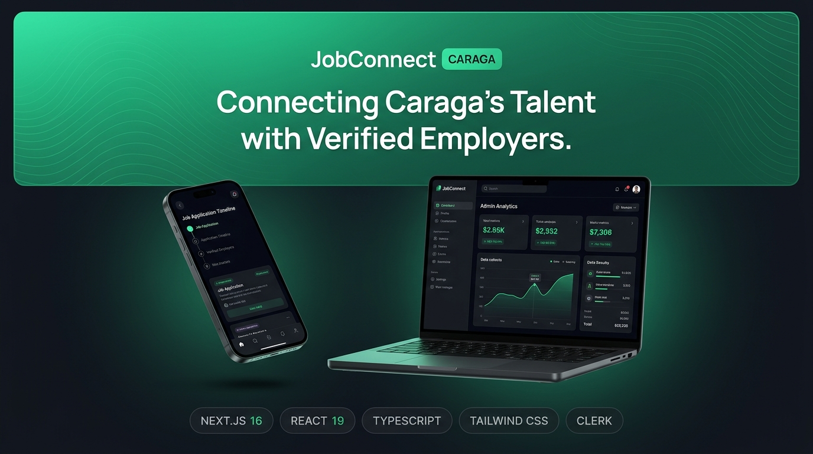

<div align="center">
  
  
  <br/>
  <br/>

  # JobConnect Caraga 🌲💼

  <p align="center">
    <strong>The Premier Employment & Talent Ecosystem for Butuan City & Region XIII</strong>
  </p>
  
  <p align="center">
    A high-performance, web-native recruitment portal built with <strong>Next.js 16 (Turbopack)</strong>, <strong>React 19</strong>, <strong>Tailwind CSS v4</strong>, and <strong>Motion</strong>.<br/>Designed with an understated Apple/Linear aesthetic, strict role-based access control, and zero AI-slop jargon.
  </p>

  <p align="center">
    <a href="https://nextjs.org/"></a>
    <a href="https://react.dev/"></a>
    <a href="https://www.typescriptlang.org/"></a>
    <a href="https://tailwindcss.com/"></a>
    <a href="LICENSE"></a>
  </p>
</div>

---

## 📑 Table of Contents
- [Overview](#-overview)
- [Core Architecture & Role Isolation](#-core-architecture--role-isolation)
- [Key Features by Role](#-key-features-by-role)
- [Design System & UI Standards](#-design-system--ui-standards)
- [Code Deep Dive](#-code-deep-dive)
  - [1. Role-Based Navigation & Permissions](#1-role-based-navigation--permissions)
  - [2. Interactive 4-Stage Application Progress Stepper](#2-interactive-4-stage-application-progress-stepper)
  - [3. Dribbble Image 4 Telemetry Dual-Bar Chart](#3-dribbble-image-4-telemetry-dual-bar-chart)
  - [4. Seamless Clerk & Supabase Drop-in State](#4-seamless-clerk--supabase-drop-in-state)
- [Directory Structure](#-directory-structure)
- [Getting Started](#-getting-started)
- [Environment Variables](#-environment-variables)
- [Verification & Production Build](#-verification--production-build)
- [License](#-license)

---

## 🌟 Overview

**JobConnect Caraga** solves regional employment fragmentation across **Butuan City**, **Cabadbaran**, **Surigao**, **Bayugan**, and **Bislig**. Built as a 100% web-native progressive application, it eliminates the need for app store downloads while offering native-grade 60 FPS interactions via Lenis smooth scrolling and fluid spring physics.

```
┌────────────────────────────────────────────────────────────────────────┐
│                        JOBCONNECT CARAGA SYSTEM                        │
├────────────────────┬────────────────────┬──────────────────────────────┤
│  🎯 JOBSEEKER      │  👔 EMPLOYER       │  🛡️ PLATFORM ADMIN           │
│  - Personal Home   │  - Recruitment Hub │  - Operational Telemetry     │
│  - 4-Stage Stepper │  - Talent Pipeline │  - Dual-Bar Analytics Chart  │
│  - 1-Click Apply   │  - Vacancy Control │  - Pending Company Approvals │
│  - CV & Portfolio  │  - CSU/FSUU Source │  - Master CSV Data Export    │
└────────────────────┴────────────────────┴──────────────────────────────┘
```

---

## 🛡️ Core Architecture & Role Isolation

JobConnect implements a strict permission model to separate regular users from administrative telemetry:

| Feature / Workspace | 🎯 Jobseeker View | 👔 Employer View | 🛡️ Platform Admin |
| :--- | :---: | :---: | :---: |
| **500K User Metrics** | ❌ Hidden | ❌ Hidden | ✅ Visible |
| **Jan–Dec Statistics Chart** | ❌ Hidden | ❌ Hidden | ✅ Interactive Tooltip |
| **Company Verification Queue** | ❌ Hidden | ❌ Hidden | ✅ One-Click Approval |
| **Master CSV Exporter** | ❌ Hidden | ❌ Hidden | ✅ Bulk Records Export |
| **Manage Live Postings** | ❌ Hidden | ✅ Company Only | ✅ System-Wide Moderation |
| **Candidate Recruitment Stages** | ❌ Read-Only | ✅ Review & Advance | ✅ Audit Queue |
| **Application Progress Stepper** | ✅ 4 Milestones | ❌ Hidden | ❌ Hidden |
| **1-Click Easy Apply Modal** | ✅ Integrated | ❌ Hidden | ❌ Hidden |
| **CV & Portfolio Builder** | ✅ Editable | ❌ Hidden | ❌ Hidden |

---

## ✨ Key Features by Role

### 1. 🎯 Jobseeker Workspace
- **Personalized Header Card**: Displays verified applicant badge, profile completeness health score (95%), next recommended action, and live interview reminders.
- **Visual Application Stepper**: Replaces static tags with real-time tracking:
  $$\text{Submitted (✓)} \longrightarrow \text{Under Review (✓)} \longrightarrow \text{Interview (🟡)} \longrightarrow \text{Final Offer (⚪)}$$
- **Smart Opportunity Filters**: Category chips (*Tech & IT*, *Design*, *Healthcare*, *Education*), location badges (*Bancasi*, *Ampayon*, *Libertad*), and transparent compensation in ₱.
- **1-Click Easy Apply**: Minimalist CossUI card with pre-attached CV and optional cover note.

### 2. 👔 Employer Hub
- **Recruitment Metrics**: Active Roles, Total Applicants (81), Scheduled Interviews, and Average Time-to-Hire (6 days).
- **Candidate Pipeline**: Live stage selector dropdown (*Submitted* $\to$ *Under Review* $\to$ *Interview Scheduled* $\to$ *Offer Extended* $\to$ *Rejected*) with instant toast feedback.
- **Vacancy Management**: Pause, reactivate, or post new vacancies without touching global platform settings.
- **Regional Talent Sourcing**: Browse verified graduates from Caraga State University (CSU), Father Saturnino Urios University (FSUU), and Saint Joseph Institute of Technology (SJIT).

### 3. 🛡️ Platform Admin (Dribbble Image 4 Blueprint)
- **6 Quick Stat Pills**: *500K Users*, *1.2K Companies*, *3.5K Active Vacancies*, *28K Applications*, *80 Pending Review*, and *20 Flagged Reports*.
- **Comparative Dual-Bar Chart**: 12-month analytics comparing posted jobs vs applications with dynamic hover tooltips (August $6.4\text{K}$).
- **Company Verification Queue**: Real-time moderation tools for business permits with single-click approvals and bulk action triggers.
- **Master Job Directory Table**: Selection checkboxes, bulk CSV exporter, city/status dropdowns, and instantaneous *Activate / Set Expired* moderation toggles.

---

## 🎨 Design System & UI Standards

JobConnect adheres to modern Apple & Linear design principles:
- **Natural Squircle Geometry**: Avoids forced balloon stadium pills in favor of refined `rounded-xl` (12px) for buttons, `rounded-2xl` (16px) for cards, and `rounded-3xl` (24px) for major sections.
- **High-Contrast Typographic Scale**: Set in **Figtree**, strictly scaled with optical weights:
  - Eyebrow Badge: `text-xs font-semibold`
  - Headline H1: `text-4xl sm:text-5xl lg:text-[56px] font-extrabold tracking-[-0.035em]`
  - Body: `text-base sm:text-lg leading-[1.65]`
- **Motion & Fluid Physics**: Micro-interactions powered by `motion/react` with spring easing `[0.16, 1, 0.3, 1]`.

---

## 💻 Code Deep Dive

### 1. Role-Based Navigation & Permissions
File: [`context/AppContext.tsx`](context/AppContext.tsx)

```typescript
export type RoleType = "jobseeker" | "employer" | "admin";

interface AppContextType {
  role: RoleType;
  setRole: (role: RoleType) => void;
  user: MockUser;
  userProfile: UserProfile;
  jobs: Job[];
  applications: Application[];
  updateJobStatus: (id: string, status: "Active" | "Pending" | "Expired") => void;
  updateApplicationStage: (appId: string, stage: Application["status"]) => void;
  // ...
}
```

### 2. Interactive 4-Stage Application Progress Stepper
File: [`app/overview/page.tsx`](app/overview/page.tsx)

```tsx
{/* 4-Stage Visual Progress Bar */}
<div className="pt-3 pb-1 border-t border-neutral-200/70">
  <div className="grid grid-cols-4 gap-2 text-center">
    {/* Step 1: Submitted */}
    <div className="flex flex-col items-center">
      <div className="w-6 h-6 rounded-full bg-emerald-500 text-white flex items-center justify-center text-xs font-bold mb-1 shadow-xs">
        ✓
      </div>
      <span className="text-[11px] font-bold text-neutral-800">Submitted</span>
      <span className="text-[10px] text-neutral-400">Oct 21</span>
    </div>

    {/* Step 2: Under Review */}
    <div className="flex flex-col items-center">
      <div className={`w-6 h-6 rounded-full flex items-center justify-center text-xs font-bold mb-1 ${
        isReview ? "bg-emerald-500 text-white shadow-xs" : "bg-neutral-200 text-neutral-500"
      }`}>
        {isReview ? "✓" : "2"}
      </div>
      <span className="text-[11px] font-bold text-neutral-800">Under Review</span>
      <span className="text-[10px] text-neutral-400">Oct 22</span>
    </div>

    {/* Step 3: Interview */}
    <div className="flex flex-col items-center">
      <div className={`w-6 h-6 rounded-full flex items-center justify-center text-xs font-bold mb-1 ${
        isInterview ? "bg-amber-500 text-white shadow-xs" : isOffer ? "bg-emerald-500 text-white" : "bg-neutral-200 text-neutral-500"
      }`}>
        {isOffer ? "✓" : "3"}
      </div>
      <span className={`text-[11px] font-bold ${isInterview ? "text-amber-800" : "text-neutral-800"}`}>
        Interview
      </span>
      <span className="text-[10px] text-neutral-400">{isInterview ? "Scheduled" : "Pending"}</span>
    </div>

    {/* Step 4: Decision */}
    <div className="flex flex-col items-center">
      <div className={`w-6 h-6 rounded-full flex items-center justify-center text-xs font-bold mb-1 ${
        isOffer ? "bg-emerald-500 text-white shadow-xs" : "bg-neutral-200 text-neutral-500"
      }`}>
        {isOffer ? "✓" : "4"}
      </div>
      <span className="text-[11px] font-bold text-neutral-800">Decision</span>
      <span className="text-[10px] text-neutral-400">Final Stage</span>
    </div>
  </div>
</div>
```

### 3. Dribbble Image 4 Telemetry Dual-Bar Chart
File: [`app/overview/page.tsx`](app/overview/page.tsx)

```tsx
<div className="flex items-end justify-between h-64 pl-10 pr-2 gap-2 sm:gap-4 relative z-10">
  {MONTHLY_STATS.map((item) => {
    const isHovered = hoveredMonth === item.month;
    const maxVal = 8000;
    const postedHeight = (item.posted * 7.5 / maxVal) * 100;
    const appHeight = (item.applications / maxVal) * 100;

    return (
      <div
        key={item.month}
        onMouseEnter={() => setHoveredMonth(item.month)}
        className="flex-1 flex flex-col items-center justify-end h-full group relative cursor-pointer"
      >
        {isHovered && (
          <div className="absolute -top-11 px-3 py-1 rounded-xl bg-[#111116] text-white text-[11px] font-extrabold shadow-xl z-30 animate-in fade-in zoom-in-95 duration-150 flex flex-col items-center">
            <span>{(item.applications / 1000).toFixed(1)}K</span>
            <div className="w-2 h-2 bg-[#111116] rotate-45 -mb-1 mt-0.5" />
          </div>
        )}

        <div className="w-full flex items-end justify-center gap-1 sm:gap-1.5 pb-2">
          <div
            style={{ height: `${Math.max(12, postedHeight)}%` }}
            className="w-2 sm:w-2.5 bg-[#111116] rounded-full transition-all duration-300 group-hover:scale-y-105"
          />
          <div
            style={{ height: `${Math.max(16, appHeight)}%` }}
            className="w-2 sm:w-2.5 bg-[#D1D5DB] rounded-full transition-all duration-300 group-hover:scale-y-105"
          />
        </div>

        <span className={`text-[11px] font-bold mt-2 transition-colors ${
          isHovered ? "text-neutral-900" : "text-neutral-400"
        }`}>
          {item.month}
        </span>
      </div>
    );
  })}
</div>
```

### 4. Seamless Clerk & Supabase Drop-in State
File: [`lib/clerk.ts`](lib/clerk.ts)

```typescript
export const isClerkConfigured = Boolean(
  process.env.NEXT_PUBLIC_CLERK_PUBLISHABLE_KEY && 
  process.env.CLERK_SECRET_KEY &&
  !process.env.NEXT_PUBLIC_CLERK_PUBLISHABLE_KEY.includes("placeholder")
);

export const DEFAULT_MOCK_USER: MockUser = {
  id: "user-maria",
  fullName: "Maria Santos",
  email: "maria.santos@caraga.tech",
  role: "jobseeker",
  location: "Bancasi, Butuan City",
  avatar: "/hero-applicant.png",
  notificationsCount: 3
};
```

---

## 📁 Directory Structure

```
jobconnect/
├── app/
│   ├── layout.tsx             # Root layout with Figtree font & AppProvider
│   ├── page.tsx               # Landing page with Lenis smooth scroll
│   ├── globals.css            # Tailwind CSS v4 & custom glassmorphism styles
│   ├── overview/
│   │   └── page.tsx           # 3-Way Role Dashboard (Seeker, Employer, Admin)
├── components/
│   ├── Navbar.tsx             # Floating frosted header with 3-way demo switcher
│   ├── Hero.tsx               # Lifestyle hero with search & proof metrics
│   ├── ExploreJobs.tsx        # Filterable regional vacancy cards
│   ├── JobCategories.tsx      # Sector grid (Tech, Healthcare, Design, Admin)
│   ├── StatsProof.tsx         # Facilitated payroll counter & partner logos
│   ├── HowItWorks.tsx         # 4-step onboarding flow
│   ├── AuthModal.tsx          # CossUI/Clerk auth card (Google, GitHub, Email)
│   ├── ApplyModal.tsx         # 1-click application submission popup
│   ├── PostJobModal.tsx       # Employer vacancy creator popup
│   ├── Footer.tsx             # Newsletter & regional accreditation
│   └── ui/                    # MagicUI & shadcn motion components
├── context/
│   └── AppContext.tsx         # Global client state, bookmarks & role management
├── lib/
│   ├── types.ts               # Core TypeScript definitions (Job, Application, etc.)
│   ├── mock-data.ts           # Regional mock dataset (CSU, FSUU, TechVenture)
│   └── clerk.ts               # Fallback mock auth & Clerk OAuth detector
└── public/
    └── hero-applicant.png     # Professional regional applicant photo
```

---

## 🚀 Getting Started

### Prerequisites
- **Node.js**: `v18.17.0` or higher (Node 20+ recommended)
- **Package Manager**: `npm`, `pnpm`, or `bun`

### Installation

```bash
# 1. Clone the repository
git clone https://github.com/xalhexi-sch/jobconnect.git
cd jobconnect

# 2. Install dependencies
npm install

# 3. Start development server with Next.js Turbopack
npm run dev
```

Open [http://localhost:3000](http://localhost:3000) in your browser.

---

## 🔐 Environment Variables

Create a `.env.local` file in the root directory to connect live services:

```env
# Optional: Live Clerk Authentication
NEXT_PUBLIC_CLERK_PUBLISHABLE_KEY=pk_test_...
CLERK_SECRET_KEY=sk_test_...

# Optional: Supabase Database (if persisting live PostgreSQL records)
NEXT_PUBLIC_SUPABASE_URL=https://your-project.supabase.co
NEXT_PUBLIC_SUPABASE_ANON_KEY=eyJhbG...
```

> **Note**: JobConnect includes an in-memory client state fallback. The application runs with 100% full interactive functionality out of the box even without API keys!

---

## 🧪 Verification & Production Build

```bash
# Run TypeScript compilation check
npx tsc --noEmit

# Compile static production build
npm run build

# Start production server
npm run start
```

---

## 📄 License

Distributed under the **MIT License**. See [`LICENSE`](LICENSE) for more information.
